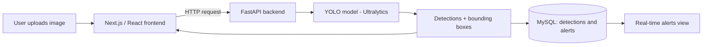

<div align="center">

# 👁️ AI CCTV Surveillance Dashboard

**Image-based object detection and safety alerts, powered by YOLO, FastAPI and Next.js**


<!-- Add a demo GIF or screenshot here, it makes the biggest difference: -->
<!--  -->

</div>

---

## 📖 Overview

This project is an **AI-powered CCTV surveillance dashboard**. Users log in, upload an image, and the backend runs **YOLO object detection** on it. The detected objects are drawn back onto the image as **bounding boxes**, and any safety violations are saved as **alerts** that show up in a live alerts view.

It combines a modern **Next.js / React** frontend with a **FastAPI** backend and a **MySQL** database.

## ✨ Features

- 🔐 **Login** to access the dashboard
- 🖼️ **Image upload and detection** using YOLO (Ultralytics)
- 🟩 **Bounding-box overlays** drawn on the detected objects
- 🚨 **Safety monitoring tabs** for reviewing detections
- 🗄️ **Persistent storage:** detections and safety alerts saved to MySQL
- ⏱️ **Real-time alerts view** powered by the stored alerts

## 🧱 How It Works



## 🛠️ Tech Stack

| Layer | Technology |
|---|---|
| Frontend | Next.js, React, [Tailwind CSS] |
| Backend | FastAPI (Python) |
| AI / CV | YOLO via Ultralytics |
| Database | MySQL |

## 📂 Project Structure

```text
object_detection/
├── frontend/     # Next.js app (login, dashboard, alerts view)
├── backend/      # FastAPI app + YOLO inference
└── README.md
```

> ✏️ Adjust the folder names above to match your repo.

## 🚀 Getting Started

### Prerequisites

- Node.js 18+
- Python 3.9+
- MySQL server running locally

### 1. Clone the repository

```bash
git clone https://github.com/Kashiish134/object_detection.git
cd object_detection
```

### 2. Set up the database

```sql
CREATE DATABASE [your_db_name];
```

Then configure the connection details (host, user, password, database) in your backend config or `.env` file.

### 3. Run the backend

```bash
cd backend
pip install -r requirements.txt
uvicorn main:app --reload
```

The API will be available at `http://127.0.0.1:8000` (interactive docs at `/docs`).

### 4. Run the frontend

```bash
cd frontend
npm install
npm run dev
```

Open `http://localhost:3000` in your browser.


## 🔭 Future Improvements

- [ ] Live video / RTSP camera stream detection
- [ ] Email or SMS notifications for critical alerts
- [ ] Custom-trained YOLO model for workplace safety (helmets, vests, etc.)
- [ ] Docker setup for one-command deployment

## 👩‍💻 Author

**Kashish Aggarwal**
[GitHub](https://github.com/Kashiish134) · [LinkedIn](https://www.linkedin.com/in/kashish-aggarwal-kashish-aggarwal)

⭐ If you found this project useful, consider giving it a star!
